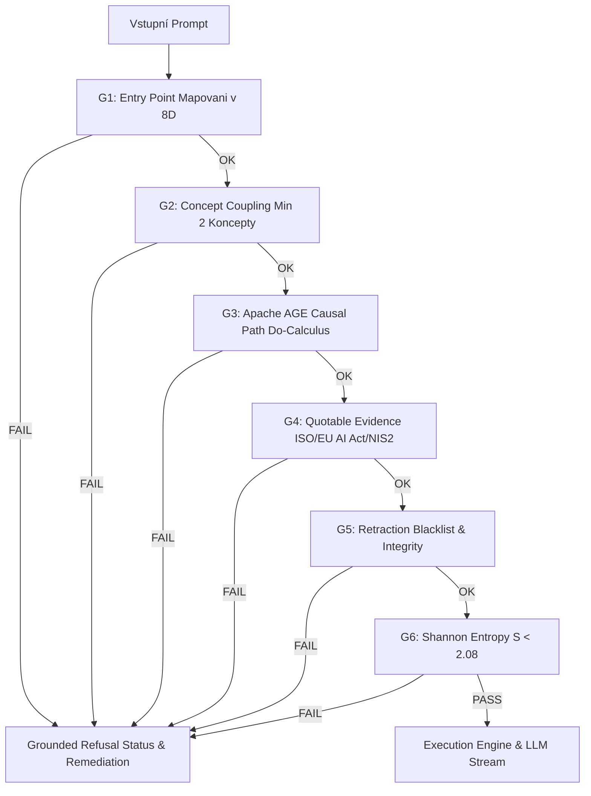

# OMNIS by Suseto – KOMPLETNÍ OPERÁTORSKÝ, TECHNICKÝ A METODICKÝ MANUÁL (v4.5 / v7.0 Production Ready)

**OMNIS by Suseto (Autonomous Polymathic Execution & Invariant Engine — AKGE-8D)** je transdisciplinární kognitivní architektura a analytický ekosystém pro Android (Kotlin 2.0 / Jetpack Compose Material 3) integrovaný s Python FastAPI backendem, sjednocenou **PostgreSQL 17** databází (`pgvector` 64D HNSW, `Apache AGE` `omnis_causal_graph`, `pgcrypto`), **ElectricSQL 1.8.1** synchronizací a **8D tenzorovou logikou** pro nelineární modelování systémových dopadů, kauzální intervence a autonomní orchestraci.

---

## 📖 ČÁST I: UŽIVATELSKÝ A OPERÁTORSKÝ MANUÁL

### 1.1 Dvoudimenzionální Systém Řízení Rozhraní (Dimenze A & B)

```mermaid
quadrantChart
    title Dvoudimenzionální Řízení Rozhraní O.M.N.I.S.
    x-axis Kognitivní Úroveň: BEGINNER --> EXPERT
    y-axis Bezpečnostní Role: STANDARD_USER --> ADMIN_OPERATOR
    quadrant-1 Správce Infrastruktury & Expert
    quadrant-2 Správce v Přehledovém Režimu
    quadrant-3 Běžný Uživatel & Začátečník
    quadrant-4 Analytik s Expertním POHLEDEM
```

Architektura rozhraní O.M.N.I.S. je řízena dvěma **ortogonálními (na sobě nezávislými) dimenzemi**:

| Dimenze | Typ Řízení | Hodnoty | Primární Účel |
| :--- | :--- | :--- | :--- |
| **Dimenze A** | **Bezpečnostní Role (RBAC)** | `STANDARD_USER` vs `ADMIN_OPERATOR` | Řízení přístupových práv k systémovým akcím, diagnostice infrastruktury a izolaci konverzací. |
| **Dimenze B** | **Kognitivní Úroveň Pokročilosti** | `BEGINNER` (`STANDARD`) vs `EXPERT` | Řízení hustoty informací, vizuální složitosti, formátu výstupů a dostupnosti pokročilých ovládacích prvků. |

---

### 1.2 Dimenze A: Logika Bezpečnostních Rolí a Vliv na Frontend

#### A. Běžný Uživatel (`STANDARD_USER`):
1. **Frontendový Routing & Navigation Layout:**
   - Směrování probíhá přes izolovaný `UserNavigationLayout` a reaktivní `UserTabRouter`.
   - `UserTopAppBar` a `UserDrawerContent` neobsahují systémové diagnostické odznaky ani servisní přepínače.
2. **Přístupné Záložky (`OmnisBottomNavigationBar`):**
   - **Chat (`CHAT`)**, **Kokpit (`DASHBOARD`)**, **8D Radar (`ANALYTICS`)**, **Scénáře (`SCENARIOS`)**, **Cíle (`GOALS`)**, **Artefakty (`ARTIFACTS`)**, **Paměť (`MEMORY`)**, **Kauzální Simulátor (`CAUSAL_SIMULATOR`)**, **Dialektika (`DIALECTICS`)**, **Neurální Nexus (`NEXUS`)**, **Průvodce (`GUIDE`)**.
3. **Izolace Dat (Multi-Tenant & RLS):**
   - Na klientu jsou vlákna filtrována dle `currentUsername`, na backendu jsou tabulky v PostgreSQL 17 chráněny politikami Row-Level Security (`omnis.current_user_id`, `omnis.current_role`).

#### B. Administrátor / Operátor (`ADMIN_OPERATOR`):
1. **Vyhrazený Layout:** `AdminNavigationLayout`, `AdminTabRouter`, `AdminTopAppBar`, `AdminDrawerContent`.
2. **Exkluzivní Moduly:**
   - **Admin Hub (`ADMIN`):** Diagnostika `AdminDbHealthCard`, stav `omnis_encrypted_db` (SQLCipher AES-256) a `omnis_sync_outbox`, synchronizace do PostgreSQL 17 / ElectricSQL, biometrický test a test JWT interceptoru.
   - **Kognitivní Uzly (`NODES`)**, **Matrix / Octagon (`MATRIX`)**, **Dev Prompt Lab (`DEV_PROMPT_LAB`)**, **Telemetrie (`TELEMETRY`)**, **Auditní Centrum (`PRODUCTION_AUDIT`)**, **Kryptografický Audit Ledger (`ZK_LEDGER`)**.

---

## 🛡️ ČÁST II: REFUSAL LADDER GATEKEEPER & PERZISTENCE (G1–G6)



### 2.1 Sjednocená Perzistenční Vrstva
1. **Android Edge (`OmnisDatabase` v18 + SQLCipher):**
   - Šifrovaná databáze `omnis_encrypted_db` využívající AES-256-CBC a klíče spravované v Android Keystore (`DatabasePassphraseProvider`).
   - Atomický zápis zpráv a událostí do `omnis_sync_outbox`, odbavovaný přes `OmnisBatchSyncWorker` a `OmnisSyncRepository` (`/api/v1/sync/batch`).
2. **Backend Core (`PostgreSQL 17` Multi-Engine — `backend/db/init.sql`):**
   - **`pgvector`**: Tabulka `public.rag_memory_64d` s HNSW kosinovým indexem (`m = 16, ef_construction = 128`) a hybridním RRF vyhledáváním (`hybrid_search_knowledge`).
   - **`Apache AGE`**: Perzistentní graf `omnis_causal_graph` synchronizovaný s `public.causal_nodes` a `public.causal_edges`. `AgeCausalGraphRepository` kompiluje neměnné `CsrGraphSnapshot` a při `LISTEN omnis_graph_invalidated` provádí lock-free atomickou výměnu reference.
   - **`pgcrypto` & `zk_audit_ledger`**: Striktě append-only auditní řetězec s transakční serializací (`pg_advisory_xact_lock`) a blokací `UPDATE`, `DELETE` i `TRUNCATE` pomocí databázových triggerů.
   - **`ElectricSQL 1.8.1`**: Logická replikace nad publikací `electric_publication_default` pro tabulky `messages`, `goals`, `rag_fragments` a `tensor_states_8d` (`REPLICA IDENTITY FULL`) s ochranným limitem `max_slot_wal_keep_size=2GB`.
3. **Ochrana Brány G5 (`retraction_watch_blacklist`):**
   - Funkce `verify_retraction_watch()` v `backend/app/db_engine.py` ověřuje dotazy proti tabulce `public.retraction_watch_blacklist`.

### 2.2 Inferenční & Bezpečnostní Kaskáda
- **Android klient:** `FirebaseAiService` (`gemini-3.8-flash` / `gemini-3.5-flash-lite`) a lokální `HybridInferenceOrchestrator` (>= 4 GB RAM práh, 1500 ms timeout, bez dynamického načítání `.so`/`.dex`/`.jar`).
- **Backend server:** `backend/app/llm_cascade.py` (Tier 1 lokální Gemma 4 -> Groq -> Gemini -> OpenRouter) a volitelné ECDSA P-256 podepisování při `ENABLE_CLOUD_KMS=true` (výchozí je deterministický `HMAC-SHA256-HASH-CHAIN`).

---

## 📂 ČÁST III: TOPOLOGICKÝ VAULT INDEX (`_OMNIS_VAULT/`)

Veškeré ontologické registry, matice dopadů, referenční orchestrátor a auditní záznamy jsou evidovány v `_OMNIS_VAULT/` pod kontrolou SHA-256 kontrolních součtů:
- `_OMNIS_VAULT/00_OMNIS_MASTER_INDEX.md` — Hlavní index závislostí a SHA-256 otisků
- `_OMNIS_VAULT/00_TOPOLOGY_GRAPH.json` — Strojově čitelný topologický graf uzlů a hran
- `_OMNIS_VAULT/01_EPISTEMIC_PLANE/entities_registry.json` (`NODE-EPI-001`)
- `_OMNIS_VAULT/02_SYNTHETIC_PLANE/apex_impact_matrices.json` (`NODE-SYN-001`)
- `_OMNIS_VAULT/03_PRAXEOLOGICAL_PLANE/code_artifacts/OmnisOrchestrator.kt` (`NODE-PRX-001`)
- `_OMNIS_VAULT/04_AUDIT_AND_REMEDIATION/defect_registry.md` (`ERR-001`)
- `_OMNIS_VAULT/04_AUDIT_AND_REMEDIATION/remediation_blueprints.md` (`FIX-001`)
- `_OMNIS_VAULT/04_AUDIT_AND_REMEDIATION/impact_verifications.md` (`IMP-001`)
- `_OMNIS_VAULT/04_AUDIT_AND_REMEDIATION/execution_roadmap.md` (`STEP-001`)
