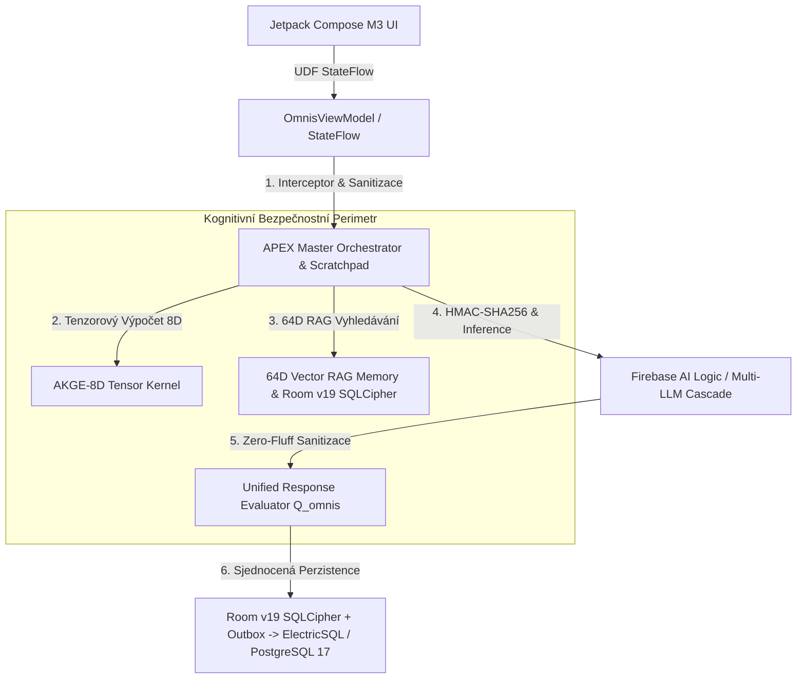
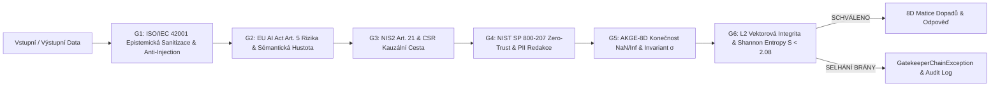
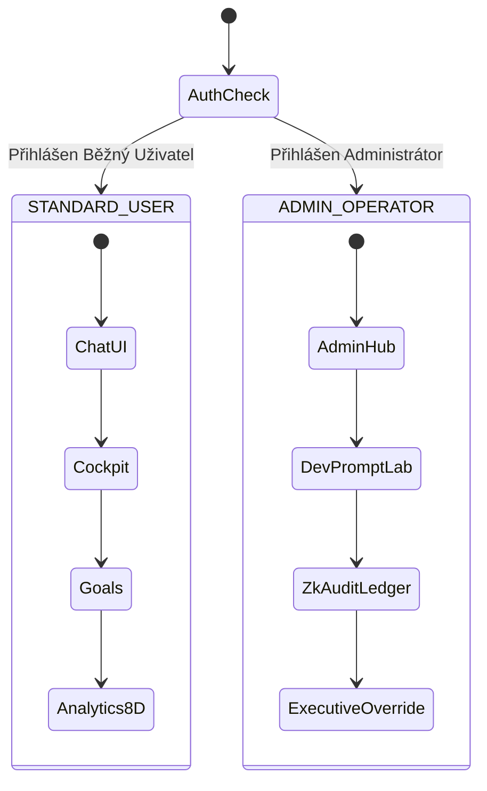

# OMNIS by Suseto (O.M.N.I.S. APEX v4.5)

**OMNIS by Suseto** (**O.M.N.I.S. APEX** — Autonomous Polymathic Execution & Invariant Engine) je transdisciplinární kognitivní architektura a exekuční platforma pro Android (Kotlin 2.0 & Jetpack Compose Material 3) integrovaná se sjednoceným open-source Python FastAPI backendem, **PostgreSQL 17** (`pgvector` 64D HNSW + `Apache AGE` kauzální graf + `pgcrypto`), **ElectricSQL 1.8.1** synchronizací a striktním Zero-Fluff výstupním validátorem.

---

## 🏗️ 1. Celková Architektura Systému & APEX Master Pipeline



### ASCII Blokové Schéma Architektury Vrstev

```
┌─────────────────────────────────────────────────────────────────────────────────┐
│                      PREZENTAČNÍ VRSTVA (Jetpack Compose M3)                    │
│  ┌──────────────────────────────────┐        ┌───────────────────────────────┐  │
│  │   STANDARD_USER Layout           │        │   ADMIN_OPERATOR Layout       │  │
│  │   (Kognitivní Chat, Kokpit, Cíle)│        │   (Admin Hub, Dev Prompt Lab) │  │
│  └─────────────────┬────────────────┘        └───────────────┬───────────────┘  │
└────────────────────┼─────────────────────────────────────────┼──────────────────┘
                     │                                         │
                     ▼                                         ▼
┌─────────────────────────────────────────────────────────────────────────────────┐
│                       KOGNITIVNÍ A AUDITNÍ RÁMEC (AKGE-8D)                      │
│  ┌──────────────────────┐  ┌──────────────────────┐  ┌────────────────────────┐ │
│  │ Refusal Ladder G1-G6 │  │ 8D Tensor Kernel     │  │ zk_audit_ledger        │ │
│  │ (Apache AGE + G5 DB) │  │ (Harmonická matice)  │  │ (Append-Only SHA-256)  │ │
│  └──────────────────────┘  └──────────────────────┘  └────────────────────────┘ │
└────────────────────┬────────────────────────────────────────────────────────────┘
                     │
                     ▼
┌─────────────────────────────────────────────────────────────────────────────────┐
│                 SJEDNOCENÁ PERZISTENCE & SYNCHRONIZACE (0 USD OSS)              │
│  ┌──────────────────────────────────┐        ┌───────────────────────────────┐  │
│  │ Room v19 + SQLCipher AES-256     │ ─────► │ PostgreSQL 17 Multi-Engine    │  │
│  │ (Transactional Outbox + Keystore)│ Sync   │ (pgvector + AGE + ElectricSQL)│  │
│  └──────────────────────────────────┘        └───────────────────────────────┘  │
└─────────────────────────────────────────────────────────────────────────────────┘
```

---

## 🌟 2. Klíčové Schopnosti a 8D Tenzorové Jádro

### 🧩 8D Funkční Matice a 28-Párový Tenzor Vazeb
Každý kognitivní podnět i systémový stav je deterministicky hodnocen napříč 8 fundamentálními dimenzemi:
$$\vec{V} = [\text{SYS}, \text{ECON}, \text{PSYCH}, \text{ECO}, \text{LAW}, \text{SEC}, \text{PHYS}, \text{SOC}]$$

```
                  ┌───────────────────────────────┐
                  │    8D RADAROVÁ DIAGNOSTIKA    │
                  └───────────────┬───────────────┘
                                  │
                                 SYS
                                  │
                       SOC ───────┼─────── ECON
                             ╲    │    ╱
                              ╲   │   ╱
                     PHYS ─────    ┼    ───── PSYCH
                              ╱   │   ╲
                             ╱    │    ╲
                       SEC ───────┼─────── ECO
                                  │
                                 LAW
```

- **SYS (Systemic)**: Architektonická provázanost, modularita a lock-free `CsrGraphSnapshot` determinismus.
- **ECON (Economic)**: Nákladová efektivita ($0/měsíc Sovereign OSS), tokenová komprese a TCO optimalizace.
- **PSYCH (Psychological)**: Kognitivní zátěž, oddělený `BEGINNER`/`EXPERT` režim a Zero-Fluff výstupy.
- **ECO (Ecological)**: Energetická stopa, lokální deterministická syntéza a omezení WAL (`max_slot_wal_keep_size=2GB`).
- **LAW (Legal)**: Regulatorní soulad (EU AI Act, GDPR čl. 15/32, NIS2, ISO/IEC 42001).
- **SEC (Security)**: Zero-Trust perimetr (NIST SP 800-207), SQLCipher AES-256-CBC, RLS a `zk_audit_ledger`.
- **PHYS (Physical)**: Hardwarová infrastruktura (`HybridInferenceOrchestrator`, práh >= 4 GB RAM, limit 1500 ms).
- **SOC (Societal)**: Společenský dopad, ochrana před social scoringem a auditovatelné přepisy (`OVERRIDE_ACTIVE`).

Všech $\binom{8}{2} = 28$ interakcí mezi doménami je kvantifikováno empirickým korelačním tenzorem $r \in [-1.0, +1.0]$, identifikujícím kritické frikce i synergie.

---

## 🛡️ 3. Dual-Gate & Logická Vrstva Gatekeeper G1–G6 (Zero-Hallucination)

Každý dotaz (vstupní větev) i vygenerovaná odpověď před vstupem do 8D Matice dopadu (výstupní větev — **Dual-Gate**) v systému O.M.N.I.S. povinně prochází sekvenční logickou vrstvou **`Gatekeeper G1–G6`** (`GatekeeperG1G6.kt` na Androidu a `backend/gateway/gatekeeper.py` na backendu):



Každá ze 6 bran povinně zapisuje svou operaci do auditního systému (`TelemetryEngine` / `omnis.gatekeeper.audit` se zřetězeným SHA-256 otiskem) a při jakémkoli selhání (např. `NaN`, `Inf`, nulový vektor, injection nebo překročení entropie) okamžitě přeruší řetězec vyhozením definované výjimky **`GatekeeperChainException`**:

1. **G1 (ISO/IEC 42001 Sec. 8.2 — Epistemická sanitizace & Anti-Injection)**: Odstranění řídicích znaků, kontrola minimální délky (`>= 3`) a blokace prompt injection / úniku direktiv (`<scratchpad>`).
2. **G2 (EU AI Act 2024/1689 Art. 5 — Klasifikace rizik & sémantická hustota)**: Blokace zakázaných AI praktik (`social scoring`, podprahová manipulace) a kontrola minimální sémantické hustoty (`>= 2` tokeny).
3. **G3 (Směrnice NIS2 Art. 21 & CSR Kauzalita)**: Blokace kybernetických útočných vektorů (ransomware, malware, DDoS) a ověření souvislé kauzální cesty `SYS -> LAW` v CSR / Apache AGE grafu.
4. **G4 (ISO/IEC 42001 & NIST SP 800-207 — Zero-Trust & PII Redakce)**: Ochrana proti obcházení Zero-Trust politiky a automatická maskace e-mailů (`[REDACTED_PII]`) i API klíčů (`[REDACTED_KEY]`).
5. **G5 (AKGE-8D — Konečnost tenzorů & Invariant $\sigma$)**: Odmítnutí `NaN`/`Inf` hodnot v 8D doménách i neplatného systémového pnutí $\sigma \notin [0.0, 0.85)$ a normalizace 8D vah do intervalu `[0, 1]`.
6. **G6 (AKGE-8D — L2 vektorová integrita & Shannonova entropie $S < 2.08$)**: Zablokování prázdných, `NaN`/`Inf` či nulových embedding vektorů, L2 normalizace a ověření bifurkačního prahu Shannonovy entropie $S = -\sum p_i \ln p_i < 2.08$.

---

## 👥 4. Prezentační Úrovně a Role-Based Access Control (RBAC)



- **`STANDARD_USER`**: Přehledný kognitivní chat, kokpit, cíle a 8D analytika bez systémového balastu; data izolována na úrovni uživatele i PostgreSQL Row-Level Security (`omnis.current_user_id`).
- **`ADMIN_OPERATOR`**: Surové 8D vektory, topologie Apache AGE / CSR, diagnostika `AdminDbHealthCard`, `DevPromptLab`, `ZkAuditLedger` a kontrolované `OVERRIDE_ACTIVE` přepisy zaznamenané do neměnného SHA-256 řetězce v `public.zk_audit_ledger`.

---

## 🏛️ 5. Architektonické Vrstvy a Technologie

| Vrstva | Technologie | Popis |
| :--- | :--- | :--- |
| **Presentation (UI)** | Jetpack Compose (M3) | 8D Canvas Radar, Octagon Dashboard, Timeline Chat (`ChatStatusBanner`), Multi-Agentní Debata, Tensor Oversight, Admin Hub |
| **Domain & Gatekeeper** | Kotlin 2.0 Coroutines | `ApexOrchestratorEngine`, `OmnisFivePhaseExecutor`, `GatekeeperG1G6` (`GatekeeperChainException`), `OmnisCircuitBreaker` (HTTP 429 `Retry-After`), `AkgeTensorKernel` |
| **Backend & Graph** | Python FastAPI / Apache AGE | `GatekeeperG1G6` (`backend/gateway/gatekeeper.py`), `AgeCausalGraphRepository`, `CsrKnowledgeGraph`, `ProviderCircuitBreaker`, `Q_omnis` validátor, `ZkAuditLedgerService` |
| **Persistence (Edge)** | Room DB v19 & SQLCipher | Offline-first AES-256-CBC šifrovaná paměť (`omnis_local_vectors_64d`, `MIGRATION_18_19`) s Android Keystore a Transactional Outbox (`omnis_sync_outbox`) |
| **Persistence (Core)** | PostgreSQL 17 + `pgvector` + `pgcrypto` | 64D HNSW index (`rag_memory_64d`), RLS politiky, least-privilege role (`omnis_app_rw`, `omnis_audit_append`, `omnis_sync_repl`), append-only triggery |
| **Sync & Cascade** | ElectricSQL 1.8.1 + LLM Cascade | Logická replikace `electric_publication_default` (`REPLICA IDENTITY FULL`), Android Firebase AI Logic & serverová kaskáda (`gemma4_local` -> Groq -> Gemini -> OpenRouter) |
| **Vault Index** | `_OMNIS_VAULT/` | Kompletní topologický a forenzní index (`00_OMNIS_MASTER_INDEX.md`, `00_TOPOLOGY_GRAPH.json`) ověřovaný SHA-256 kontrolními součty |

---

## 🚀 6. Příkazy pro Sestavení a Verifikaci (CI/CD: `production-ci-cd.yml`)

```bash
# 1. Kontrola syntaxe a Integrity Gate (init.sql, docker-compose.yml, _OMNIS_VAULT SHA-256, unittest)
python3 -m py_compile $(find backend scripts -name "*.py")
./scripts/verify_and_clean_legacy.sh --verify-only

# 2. Plný backend Quality Gate (v prostředí s nainstalovanými závislostmi z backend/requirements.txt)
PYTHONPATH=. pytest backend/ --cov=backend --cov-branch --cov-report=xml:coverage.xml --cov-fail-under=80
python3 scripts/verify_quality_gate.py --coverage-xml coverage.xml

# 3. Spuštění sjednocené infrastruktury mimo Google Cloud (PostgreSQL 17 + ElectricSQL + Backend + Caddy)
# Kompletní krok-za-krokem návod pro registraci a nasazení zdarma viz: DEPLOYMENT_FREE_NON_GCP.md
docker compose up -d --build
./scripts/verify_cutover.sh

# 4. Android Unit & Robolectric testy + produkční Release APK/AAB + SHA-256 součty
./scripts/release_v4_5_0.sh
```

---

## 📦 7. Poznámky k Vydání `v4.5.0-GA`

- **CI/CD & Provenance:** Sjednocený workflow `.github/workflows/production-ci-cd.yml` (Detekt, `pytest` s pokrytím ≥ 80 %, `ruff`, `bandit`, `radon`, Android `:app:testDebugUnitTest`, R8 release APK/AAB a automatické vystavení `SIGNING_STATUS.txt` se stavem `SIGNED` nebo `UNSIGNED_R8_ONLY` + `SHA256SUMS.txt`).
- **Sjednocená Perzistence:** PostgreSQL 17 (`pgvector`, `Apache AGE`, `pgcrypto`), `ElectricSQL 1.8.1`, Android Room **v19** + SQLCipher AES-256 s lokálním 64D vektorovým úložištěm (`omnis_local_vectors_64d`, `MIGRATION_18_19`).
- **Kognitivní Jádro, Gatekeeper G1–G6 & Circuit Breaker:** Sekvenční vrstva `Gatekeeper G1–G6` před 8D maticí dopadů (s auditním logováním každé brány a `GatekeeperChainException` při `NaN`/`Inf`/nulových vektorech), Dual-Gate na vstupu i výstupu, jednotný HTTP 429 `Retry-After` cooldown `[5, 300]` s v `OmnisCircuitBreaker` / `ProviderCircuitBreaker` s přehledem v `ChatStatusBanner`, konstantně-časová verifikace `zk_audit_ledger` a striktní RBAC izolace.
- **Android Production Release:** `versionCode = 450`, `versionName = 4.5.0`, R8 minifikace a shrink resources (`proguard-rules.pro`) a environmentální podpis (`OMNIS_KEYSTORE_FILE` / GitHub Secret `OMNIS_KEYSTORE_BASE64`).

---

## 📤 8. Příprava a Nahrání na GitHub

Repozitář neobsahuje `.env`, `local.properties` ani soukromé API klíče (`.gitignore` vylučuje lokální keystore, databáze, cache i `release-artifacts/` / `release-v*/`). Pro první nahrání na GitHub a spuštění CI/CD:

```bash
git init -b main
git add .
git commit -m "chore: prepare O.M.N.I.S. APEX v4.5.0-GA release and docs"
git remote add origin https://github.com/suseto-ui/OMNIS.git
git push -u origin main
```

Volitelné a doporučené GitHub Actions Secrets (viz detailně `DEPLOYMENT_FREE_NON_GCP.md` Krok 8):
- `OMNIS_BACKEND_URL`, `OCI_VM_HOST`, `OCI_VM_USER`, `OCI_SSH_PRIVATE_KEY`, `SONAR_TOKEN`
- Pro produkčně podepsaný APK/AAB v `production-ci-cd.yml`: `OMNIS_KEYSTORE_BASE64`, `OMNIS_KEYSTORE_PASSWORD`, `OMNIS_KEY_ALIAS`, `OMNIS_KEY_PASSWORD` (bez nich CI vygeneruje nepodepsaný R8 build označený `UNSIGNED_R8_ONLY`).

---

## ✉️ Kontakt & Repozitář
* **GitHub Repository:** [https://github.com/suseto-ui/OMNIS](https://github.com/suseto-ui/OMNIS)
* **Email:** suseto.servis@gmail.com
