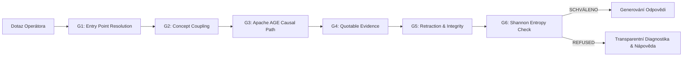
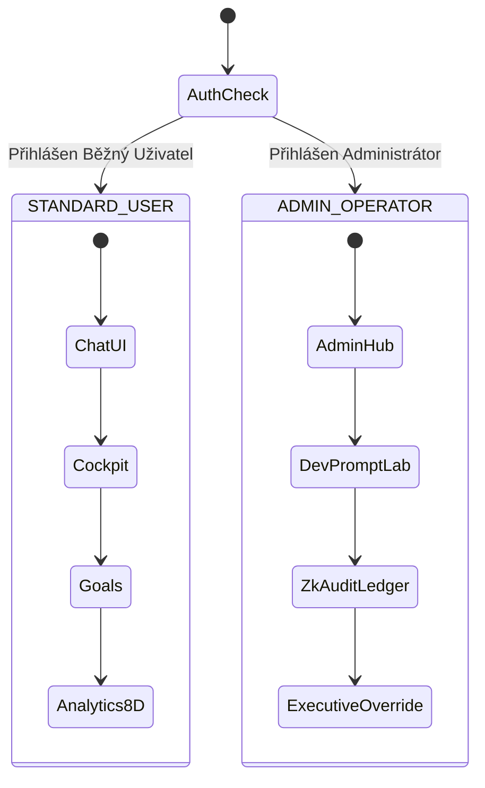

# O.M.N.I.S. APEX v4.5 / v7.0 (Autonomous Polymathic Execution & Invariant Engine)

**O.M.N.I.S. APEX** (**OMNIS by Suseto**) je transdisciplinární kognitivní architektura a exekuční platforma pro Android (Kotlin 2.0 & Jetpack Compose Material 3) integrovaná se sjednoceným open-source Python FastAPI backendem, **PostgreSQL 17** (`pgvector` 64D HNSW + `Apache AGE` kauzální graf + `pgcrypto`), **ElectricSQL 1.8.1** synchronizací a striktním Zero-Fluff výstupním validátorem.

---

## 🏗️ 1. Celková Architektura Systému & APEX Master Pipeline


### ASCII Blokové Schéma Architektury Vrstev

```
┌─────────────────────────────────────────────────────────────────────────────────┐
│                      PREZENTAČNÍ VRSTVA (Jetpack Compose M3)                    │
│  ┌──────────────────────────────────┐        ┌───────────────────────────────┐  │
│  │   STANDARD_USER Layout           │        │   ADMIN_OPERATOR Layout       │  │
│  │   (Kognitivní Chat, Kokpit, Cíle)│        │   (Admin Hub, Dev Prompt Lab) │  │
│  └─────────────────┬────────────────┘        └───────────────┬───────────────┘  │
└────────────────────┼─────────────────────────────────────────┼──────────────────┘
                     │                                         │
                     ▼                                         ▼
┌─────────────────────────────────────────────────────────────────────────────────┐
│                       KOGNITIVNÍ A AUDITNÍ RÁMEC (AKGE-8D)                      │
│  ┌──────────────────────┐  ┌──────────────────────┐  ┌────────────────────────┐ │
│  │ Refusal Ladder G1-G6 │  │ 8D Tensor Kernel     │  │ zk_audit_ledger        │ │
│  │ (Apache AGE + G5 DB) │  │ (Harmonická matice)  │  │ (Append-Only SHA-256)  │ │
│  └──────────────────────┘  └──────────────────────┘  └────────────────────────┘ │
└────────────────────┬────────────────────────────────────────────────────────────┘
                     │
                     ▼
┌─────────────────────────────────────────────────────────────────────────────────┐
│                 SJEDNOCENÁ PERZISTENCE & SYNCHRONIZACE (0 USD OSS)              │
│  ┌──────────────────────────────────┐        ┌───────────────────────────────┐  │
│  │ Room v18 + SQLCipher AES-256     │ ─────► │ PostgreSQL 17 Multi-Engine    │  │
│  │ (Transactional Outbox + Keystore)│ Sync   │ (pgvector + AGE + ElectricSQL)│  │
│  └──────────────────────────────────┘        └───────────────────────────────┘  │
└─────────────────────────────────────────────────────────────────────────────────┘
```

---

## 🌟 2. Klíčové Schopnosti a 8D Tenzorové Jádro

### 🧩 8D Funkční Matice a 28-Párový Tenzor Vazeb
Každý kognitivní podnět i systémový stav je deterministicky hodnocen napříč 8 fundamentálními dimenzemi:
$$\vec{V} = [\text{SYS}, \text{ECON}, \text{PSYCH}, \text{ECO}, \text{LAW}, \text{SEC}, \text{PHYS}, \text{SOC}]$$

```
                  ┌───────────────────────────────┐
                  │    8D RADAROVÁ DIAGNOSTIKA    │
                  └───────────────┬───────────────┘
                                  │
                                 SYS
                                  │
                       SOC ───────┼─────── ECON
                             ╲    │    ╱
                              ╲   │   ╱
                     PHYS ─────    ┼    ───── PSYCH
                              ╱   │   ╲
                             ╱    │    ╲
                       SEC ───────┼─────── ECO
                                  │
                                 LAW
```

- **SYS (Systemic)**: Architektonická provázanost, modularita a lock-free `CsrGraphSnapshot` determinismus.
- **ECON (Economic)**: Nákladová efektivita ($0/měsíc Sovereign OSS), tokenová komprese a TCO optimalizace.
- **PSYCH (Psychological)**: Kognitivní zátěž, oddělený `BEGINNER`/`EXPERT` režim a Zero-Fluff výstupy.
- **ECO (Ecological)**: Energetická stopa, lokální deterministická syntéza a omezení WAL (`max_slot_wal_keep_size=2GB`).
- **LAW (Legal)**: Regulatorní soulad (EU AI Act, GDPR čl. 15/32, NIS2, ISO/IEC 42001).
- **SEC (Security)**: Zero-Trust perimetr (NIST SP 800-207), SQLCipher AES-256-CBC, RLS a `zk_audit_ledger`.
- **PHYS (Physical)**: Hardwarová infrastruktura (`HybridInferenceOrchestrator`, práh >= 4 GB RAM, limit 1500 ms).
- **SOC (Societal)**: Společenský dopad, ochrana před social scoringem a auditovatelné přepisy (`OVERRIDE_ACTIVE`).

Všech $\binom{8}{2} = 28$ interakcí mezi doménami je kvantifikováno empirickým korelačním tenzorem $r \in [-1.0, +1.0]$, identifikujícím kritické frikce i synergie.

---

## 🛡️ 3. 6-Úrovňový Refusal Ladder Gatekeeper (Zero-Hallucination)

Každý dotaz i odpověď v systému O.M.N.I.S. povinně prochází 6 rigorózními verifikačními branami:



1. **G1 (Entry Point Resolution)**: Identifikace a mapování vstupních uzlů v 8D ontologii.
2. **G2 (Concept Coupling)**: Provázání minimálně 2 konceptů a sémantická sanitizace.
3. **G3 (Causal Graph Path)**: Ověření existence souvislé kauzální cesty v Apache AGE (`omnis_causal_graph`) / CSR grafu pomocí Judea Pearl Do-Calculus $P(Y \mid do(X=x))$.
4. **G4 (Quotable Evidence)**: Důkazní ukotvení vůči normativním standardům (ISO/IEC 42001, NIST SP 800-207, EU AI Act, NIS2).
5. **G5 (Retraction & Integrity)**: Ochrana proti prompt injection a kontrola proti tabulce `retraction_watch_blacklist`.
6. **G6 (Entailment & Shannon Entropy)**: Striktní logická dedukce a výpočet informační entropie $S = -\sum p_i \ln p_i < 2.08$.

---

## 👥 4. Prezentační Úrovně a Role-Based Access Control (RBAC)



- **`STANDARD_USER`**: Přehledný kognitivní chat, kokpit, cíle a 8D analytika bez systémového balastu; data izolována na úrovni uživatele i PostgreSQL Row-Level Security (`omnis.current_user_id`).
- **`ADMIN_OPERATOR`**: Surové 8D vektory, topologie Apache AGE / CSR, diagnostika `AdminDbHealthCard`, `DevPromptLab`, `ZkAuditLedger` a kontrolované `OVERRIDE_ACTIVE` přepisy zaznamenané do neměnného SHA-256 řetězce v `public.zk_audit_ledger`.

---

## 🏛️ 5. Architektonické Vrstvy a Technologie

| Vrstva | Technologie | Popis |
| :--- | :--- | :--- |
| **Presentation (UI)** | Jetpack Compose (M3) | 8D Canvas Radar, Octagon Dashboard, Timeline Chat, Admin Hub |
| **Domain Logic** | Kotlin 2.0 Coroutines | `ApexOrchestratorEngine`, `OmnisFivePhaseExecutor`, `AkgeTensorKernel` (perkolace $p_c \ge 0.38$), `HybridInferenceOrchestrator` |
| **Backend & Graph** | Python FastAPI / Apache AGE | `AgeCausalGraphRepository` (`LISTEN omnis_graph_invalidated`), `CsrKnowledgeGraph`, `Q_omnis` validátor, `ZkAuditLedgerService` |
| **Persistence (Edge)** | Room DB v18 & SQLCipher | Offline-first AES-256-CBC šifrovaná paměť s Android Keystore a Transactional Outbox (`omnis_sync_outbox`) |
| **Persistence (Core)** | PostgreSQL 17 + `pgvector` + `pgcrypto` | 64D HNSW index (`rag_memory_64d`), RLS politiky, least-privilege role (`omnis_app_rw`, `omnis_audit_append`, `omnis_sync_repl`), append-only triggery |
| **Sync & Cascade** | ElectricSQL 1.8.1 + LLM Cascade | Logická replikace `electric_publication_default` (`REPLICA IDENTITY FULL`), Android Firebase AI Logic (`gemini-3.8-flash` / `gemini-3.5-flash-lite`) & serverová kaskáda (`gemma4_local` -> Groq -> Gemini -> OpenRouter) |
| **Vault Index** | `_OMNIS_VAULT/` (v7.0) | Kompletní topologický a forenzní index (`00_OMNIS_MASTER_INDEX.md`, `00_TOPOLOGY_GRAPH.json`) ověřovaný SHA-256 kontrolními součty |

---

## 🚀 6. Příkazy pro Sestavení a Verifikaci (CI/CD: `omnis-ci.yml`)

```bash
# 1. Kontrola syntaxe a Integrity Gate (init.sql, docker-compose.yml, _OMNIS_VAULT SHA-256, unittest)
python3 -m py_compile $(find backend scripts -name "*.py")
./scripts/pre_deletion_gate.sh

# 2. Plný backend Quality Gate (v prostředí s nainstalovanými závislostmi z backend/requirements.txt)
PYTHONPATH=. pytest backend/ --cov=backend --cov-branch --cov-report=xml:coverage.xml --cov-fail-under=80
python3 scripts/verify_quality_gate.py --coverage-xml coverage.xml

# 3. Spuštění sjednocené infrastruktury mimo Google Cloud (PostgreSQL 17 + ElectricSQL + Backend + Caddy)
# Kompletní krok-za-krokem návod pro registraci a nasazení zdarma viz: DEPLOYMENT_FREE_NON_GCP.md
docker compose up -d --build
./scripts/verify_cutover.sh

# 4. Android Unit & Robolectric testy + produkční Release AAB (s vlastní doménou mimo GCP)
gradle :app:testDebugUnitTest --no-daemon
gradle :app:bundleRelease -POMNIS_BACKEND_URL=https://tvoje-domena.duckdns.org --no-daemon
```

---

## ✉️ Kontakt & Repozitář
* **GitHub Repository:** [https://github.com/suseto-ui/OMNIS](https://github.com/suseto-ui/OMNIS)
* **Email:** suseto.servis@gmail.com
